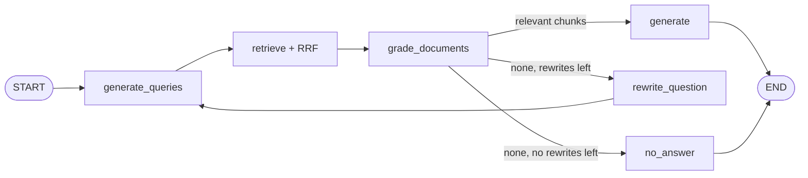

# rag-agent

A question-answering system over 10 research papers on RAG and LLM post-training, built with LangGraph.
It compares four retrieval pipelines, evaluates them with an LLM judge and evidence-level retrieval metrics,
and traces each retrieval failure to its cause.

**Main finding:** the bottleneck was **ranking**, and a cross-encoder reranker fixed most of it.
The baseline retriever put the evidence chunk in the top 5 for only 50% of held-out questions, but in the top 20
for 75%. Multi-query rewriting and CRAG-style grading only work with the top 5 chunks, so they could not reach the
evidence ranked 6–20 and made no clear difference. Retrieving 20 candidates and reranking them with a small
cross-encoder raised evidence hit from 0.50 to 0.75 and answer coverage from 0.62 to 0.76,
for +0.2 s latency and no extra LLM calls.

---

## Pipelines

Four configurations of one LangGraph graph (`rag_graph.py`, `build_graph(multi_query, crag, use_rerank)`):

| Config | What it does |
|---|---|
| `baseline` | Embed the question, retrieve the top 5 chunks, answer with citations |
| `multi_query` | An LLM writes 4 alternative queries; retrieve for all 5 queries in parallel and fuse the results with Reciprocal Rank Fusion (k=60) into the top 5 |
| `mq_crag` | `multi_query` + an LLM grader that drops irrelevant chunks. If none are left, rewrite the query once and search again; if still none, return a fixed "not found" answer |
| `rerank` | Retrieve the top 20 chunks, score each (question, chunk) pair with a cross-encoder (`cross-encoder/ms-marco-MiniLM-L-6-v2`), keep the best 5 |



*(`mq_crag` shown. `baseline` is START → retrieve → generate → END.
`rerank` is START → retrieve (k=20) → rerank (top 5) → generate → END.)*

Design choices:
- The grader and the reranker always score chunks against the **original** question, not a rewritten query, so rewriting cannot drift the topic.
- The "not found" answer is set by code (`NO_ANSWER`), not left to the model.
- `MAX_REWRITES = 1` bounds cost and latency.
- The reranker candidate count (`CANDIDATES = 20`) was fixed before looking at any results, not tuned on the questions.
- Why two stages: the embedding retriever (bi-encoder) encodes question and chunk separately, so chunk vectors can be precomputed and searched fast, but a long chunk is compressed into one vector and a small relevant detail gets diluted. The cross-encoder reads question and chunk together, so it is more accurate but must run once per pair; it is only affordable on a small candidate set.

## Corpus and index

10 papers (PDFs not committed; download them into `data/` with these file names):

| File | Paper |
|---|---|
| `rag_lewis.pdf` | Lewis et al., Retrieval-Augmented Generation for Knowledge-Intensive NLP Tasks ([arXiv 2005.11401](https://arxiv.org/abs/2005.11401)) |
| `self_rag.pdf` | Asai et al., Self-RAG ([arXiv 2310.11511](https://arxiv.org/abs/2310.11511)) |
| `crag.pdf` | Yan et al., Corrective Retrieval Augmented Generation ([arXiv 2401.15884](https://arxiv.org/abs/2401.15884)) |
| `raptor.pdf` | Sarthi et al., RAPTOR ([arXiv 2401.18059](https://arxiv.org/abs/2401.18059)) |
| `hyde.pdf` | Gao et al., Precise Zero-Shot Dense Retrieval without Relevance Labels ([arXiv 2212.10496](https://arxiv.org/abs/2212.10496)) |
| `lora.pdf` | Hu et al., LoRA ([arXiv 2106.09685](https://arxiv.org/abs/2106.09685)) |
| `qlora.pdf` | Dettmers et al., QLoRA ([arXiv 2305.14314](https://arxiv.org/abs/2305.14314)) |
| `dpo.pdf` | Rafailov et al., Direct Preference Optimization ([arXiv 2305.18290](https://arxiv.org/abs/2305.18290)) |
| `instructgpt.pdf` | Ouyang et al., Training language models to follow instructions with human feedback ([arXiv 2203.02155](https://arxiv.org/abs/2203.02155)) |
| `llm_as_judge_mtbench.pdf` | Zheng et al., Judging LLM-as-a-Judge with MT-Bench and Chatbot Arena ([arXiv 2306.05685](https://arxiv.org/abs/2306.05685)) |

Index (`index.py`): one document per PDF page → `RecursiveCharacterTextSplitter` (1000 chars, 150 overlap) →
1129 chunks → `text-embedding-3-small` (512 dims) → Chroma, persisted to `chroma_db/`.
Each chunk keeps `paper`, `page` (0-based) and `start_index` metadata.

Models: `gpt-4o-mini` for query generation, grading, rewriting and answering; `gpt-4o` as the evaluation judge;
`cross-encoder/ms-marco-MiniLM-L-6-v2` (~90 MB, runs on CPU) as the reranker.

## Setup

```bash
uv sync
echo "OPENAI_API_KEY=sk-..." > .env      # never commit .env
# optional, if huggingface.co is slow or blocked:
echo "HF_ENDPOINT=https://hf-mirror.com" >> .env
# put the 10 PDFs in data/
uv run python index.py                   # builds chroma_db/ on first run
uv run python rag_graph.py               # demo questions with the rerank pipeline
```

## Evaluation

### Question set (`questions.json`)

16 hand-written questions, each with a reference answer, key points, source papers and short **evidence
snippets** (verbatim sentences from the paper that support the answer):

| Type | Count | Example |
|---|---|---|
| factual | 4 | On average, how many bits per parameter does QLoRA's double quantization save? |
| conceptual | 6 | How does HyDE decompose dense retrieval? |
| comparison | 4 | How does CRAG differ from conventional RAG? |
| unanswerable | 2 | How does GRPO estimate advantages without a learned value model? (not in the corpus) |

Two questions (q10, q16) were used while building the pipeline and are marked `dev: true`.
**Headline numbers are on the 14 held-out questions.**

`check_questions.py` verifies, without API calls, that every source exists, every evidence snippet really
appears in its paper, and the keywords of unanswerable questions appear nowhere in the corpus.

### Metrics (`evaluate.py`)

| Metric | Meaning |
|---|---|
| `retrieval_hit` | A required source **paper** is among the chunks passed to the answer step |
| `evidence_hit_pre` | An evidence snippet is in the chunks **before** any filtering step (before CRAG grading, or among the 20 candidates before reranking) |
| `evidence_hit` | An evidence snippet is in the chunks passed to the answer step |
| `coverage` | Fraction of key points the answer covers (gpt-4o judge, one yes/no call per key point) |
| `false_refusal` | The system declined an answerable question |
| `abstained` | The system declined an unanswerable question (higher is better) |
| `latency` | Seconds per question |

`evidence_hit_pre = True, evidence_hit = False` means the right chunk was found but then dropped by the CRAG
grader or ranked out of the top 5 by the reranker.
Each question runs twice per config (`N_RUNS = 2`) because the pipeline is not deterministic.

### Results

**Held-out questions (dev excluded; 12 answerable + 2 unanswerable, 2 runs each)**

| config | retrieval_hit | evidence_hit_pre | evidence_hit | coverage | false_refusal | abstained | latency (s) |
|---|---|---|---|---|---|---|---|
| baseline | 1.000 | 0.500 | 0.500 | 0.618 | 0.083 | 1.0 | 1.7 |
| multi_query | 1.000 | 0.458 | 0.458 | 0.646 | 0.083 | 1.0 | 3.2 |
| mq_crag | 0.917 | 0.500 | 0.500 | 0.559 | 0.083 | 1.0 | 4.9 |
| **rerank** | 1.000 | 0.750 | **0.750** | **0.760** | 0.083 | 1.0 | **2.0** |

**Coverage per question (mean of 2 runs)**

| id | type | dev | baseline | multi_query | mq_crag | rerank |
|---|---|---|---|---|---|---|
| q01 | conceptual | | 0.67 | 0.67 | 0.67 | 0.67 |
| q02 | conceptual | | 0.50 | 0.50 | 0.50 | **1.00** |
| q03 | factual | | 1.00 | 1.00 | 1.00 | 1.00 |
| q04 | conceptual | | 0.25 | 0.38 | 0.50 | 0.50 |
| q05 | conceptual | | 1.00 | 1.00 | 0.75 | 1.00 |
| q06 | factual | | 1.00 | 1.00 | 1.00 | 1.00 |
| q07 | factual | | 0.00 | 0.00 | 0.00 | 0.00 |
| q08 | factual | | 1.00 | 1.00 | 1.00 | 1.00 |
| q09 | conceptual | | 0.33 | 0.33 | 0.33 | **1.00** |
| q10 | comparison | ✓ | 0.50 | 0.00 | 0.50 | *0.00* |
| q11 | comparison | | 0.67 | 0.50 | 0.33 | *0.33* |
| q12 | comparison | | 0.75 | 0.75 | 0.38 | 0.88 |
| q13 | comparison | | 0.25 | 0.62 | 0.25 | **0.75** |
| q16 | conceptual | ✓ | 1.00 | 1.00 | 1.00 | 1.00 |

What the numbers say:
- **Reranking is the only clear gain.** Held-out coverage +0.14 over baseline, evidence hit +0.25, latency +0.2 s, no extra LLM calls. Multi-query and CRAG cost 2–3x the latency for no measurable gain.
- **The evaluation agrees with the diagnostic.** For `rerank`, `evidence_hit_pre` = 0.75 equals Recall@20 and `evidence_hit` = 0.75 equals Recall@5 after reranking (see below), from two separate scripts.
- **Paper-level hit is misleading.** `retrieval_hit` is 1.0 for baseline, but the evidence chunk reaches the answer step for only half of the questions.
- **Multi-query fusion can push the evidence out of the top 5.** Baseline's own query is one of the five fused queries, yet `evidence_hit` drops: RRF promotes chunks that several rewritten queries agree on, which are not always the evidence chunk.
- **Reranking helped conceptual questions most** (held-out conceptual coverage 0.55 → 0.83) and was mixed on comparisons: better on q12 and q13, worse on q11 and the dev question q10 (see failure 7).
- **mq_crag's lower `retrieval_hit`** comes from q07, where CRAG returns the fixed "not found" answer, so no chunks reach the answer step.

Run-to-run noise: across three full runs, baseline held-out coverage ranged 0.556–0.618 and multi_query 0.608–0.646.
The rerank gain (+0.14) is about twice that range. With 12 answerable held-out questions, one question is 8.3 points
of any rate metric, so smaller gaps between configs are not conclusive. An earlier run suggested multi-query helped
comparison questions; it did not repeat in the latest run, so it is treated as noise.

### Recall@k diagnostic (`recall_at_k.py`)

Search with the raw question (top 30), find the rank of the first chunk that contains an evidence snippet,
then rerank the top 20 with the cross-encoder and find the rank again. Recall@k is the fraction of questions
with rank ≤ k. No LLM calls.

| subset | @1 | @3 | @5 | @10 | @20 | @30 |
|---|---|---|---|---|---|---|
| held-out, before rerank | 0.167 | 0.250 | 0.500 | 0.667 | 0.750 | 0.833 |
| held-out, after rerank | **0.333** | **0.667** | **0.750** | 0.750 | 0.750 | – |
| all answerable, before rerank | 0.143 | 0.214 | 0.429 | 0.571 | 0.714 | 0.857 |
| all answerable, after rerank | 0.286 | 0.571 | 0.643 | 0.714 | 0.714 | – |

Evidence rank per question, before → after reranking:

| id | before | after | | id | before | after |
|---|---|---|---|---|---|---|
| q01 | 29 | >20 | | q08 | 4 | 1 |
| q02 | 6 | **3** | | q09 | >30 | >20 |
| q03 | 1 | 3 | | q10 (dev) | 15 | 6 |
| q04 | 6 | **2** | | q11 | 4 | 1 |
| q05 | 5 | 2 | | q12 | 3 | 4 |
| q06 | 1 | 1 | | q13 | 14 | **1** |
| q07 | >30 | >20 | | q16 (dev) | 23 | >20 |

Reranking only reorders the 20 candidates, so Recall@20 is unchanged. After reranking, Recall@5 reaches that
ceiling on held-out questions: every held-out question whose evidence was among the candidates now has it in
the top 5. Two questions dropped slightly (q03 1 → 3, q12 3 → 4) but stayed in the top 5. The remaining
misses (q01, q07, q09) were never among the candidates, so the bottleneck has moved from **ranking** to
**first-stage recall**.

A direct example of the difference between the two stages, for the query `What is Q-BLEU?`: the embedding
retriever's top 5 were all tables of BLEU / ROUGE scores (it matched "BLEU" in general), and the chunk that
defines Q-BLEU was ranked 12th. The cross-encoder ranked that chunk 1st.

## Failure analysis

**1. Question wording (q07, Q-BLEU).** The evidence chunk exists, but its rank depends strongly on the wording:

| Query | Rank of evidence chunk |
|---|---|
| In the original RAG paper by Lewis et al., what is the Q-BLEU metric? (eval question) | >30 |
| What is Q-BLEU? | 12 |
| Q-BLEU metric variant of BLEU matching entities | 6 |

The paper reference ("original RAG paper by Lewis et al.") pulls the query vector toward chunks about RAG in
general; it should be a metadata filter (`paper == rag_lewis`), not part of the semantic query. Even a
keyword-dense query only reaches rank 6, because the Q-BLEU sentence is a small part of a chunk about other
topics. A rare term like "Q-BLEU" is what BM25 matches well. The reranker cannot help with the eval wording,
because the chunk is not among the 20 candidates.

**2. CRAG rewriting kept the bad part of the query (q07).** The grader correctly rejected all 5 chunks, but the
rewriter produced `Q-BLEU metric definition in RAG paper Lewis et al.`, keeping the phrase that hurt
retrieval. The second search failed the same way, and the system returned the fixed "not found" answer.
An honest refusal, but not a fix.

**3. The CRAG grader never dropped an evidence chunk.** For `mq_crag`, `evidence_hit_pre == evidence_hit` in every
run. When evidence was missing, it was because retrieval never found it, not because the grader removed it.

**4. The grader is lenient on off-topic questions (q14, GRPO).** In most runs it kept a DPO chunk as "relevant", so the
pipeline skipped `no_answer` and went to `generate`. The answer model still declined, so `abstained` stayed 1,
but the deterministic fallback did not trigger. The grading prompt accepts partial relevance.

**5. Answers stay grounded even when the evidence chunk is missed (q05, q09).** Conceptual questions had low
evidence hit but coverage around 0.5–0.6 for baseline, which could mean the answer model was using its own
knowledge. Inspecting answers against the retrieved chunks showed it was not:
- q09: the answer described reflection tokens from the retrieved chunks but did **not** add the retrieval /
  critique token split, which was only in a chunk that was not retrieved (coverage 1/3).
- q05: the answer said HyDE splits retrieval into "NLU and NLG tasks". This phrasing is in the paper
  (`hyde p.1`, start 1764); the more specific description is in the **adjacent** chunk (start 922),
  which was not retrieved.

One caveat: when the PDF text of a formula was garbled (`B 2 Rd r`), the answer wrote it correctly in LaTeX
(`B \in \mathbb{R}^{d \times r}`), so the model does fill in formatting from its own knowledge.

**6. Evidence-level hit is a lower bound (q09 with rerank).** With reranking, q09 reached coverage 1.0 although the
annotated evidence chunk was not among the candidates: the reranker found another chunk that states the same
retrieval / critique token split. A chunk that gives the answer in other words is not counted as a hit.

**7. Reranking can prefer the wrong kind of relevance on comparison questions (q10, q11).** The cross-encoder
scores how relevant a chunk is to the question text, and for "How does X differ from Y?" the chunks that mention
X and Y most often are experiment results and related work, not method descriptions:
- q10 (DPO vs PPO-based RLHF, dev): 4 of the 5 chunks came from DPO's experiments section (p.6–9) and compared
  the two methods' **performance** (reward/KL frontier, hyperparameter sensitivity). The question asks how they
  differ in **mechanism** (no reward model, change of variables), so the answer missed every key point (coverage 0).
- q11 (Self-RAG vs conventional RAG): 3 of the 5 chunks came from the **CRAG** paper, whose experiments use
  Self-RAG as a baseline and mention both names often. The Self-RAG chunks explaining on-demand retrieval were
  pushed out, and the answer missed that point (coverage 1/3).

This is not a lack of paper diversity (q10 did include InstructGPT), but a mismatch between topical relevance and the
aspect the question asks about. The reranker was trained on MS MARCO web search and has no notion of
"method section". These two questions motivated the "decompose, then rerank" idea under Next steps.

**8. PDF extraction noise.** Figure text is indexed as body text (e.g. `hyde p.1` start 0 mixes example queries
about wisdom teeth, COVID-19 and Korean text from Figure 1). Math is garbled (`W0 2 Rd k`), and some spaces
or ligatures are lost (`training,W0`, `forB`), which also constrains which evidence snippets can be matched.

### Annotation changes after inspection

Some facts appear in several places in a paper (e.g. both the abstract and the method section), while the
evidence originally listed only one location. After inspecting retrieval failures we added evidence for the
additional locations in q04 (the low-rank update and frozen weights, not only the initialization) and q05 (the
abstract). We chose them by reading the chunk text, not by retrieval rank, and added one snippet per key point.
These changes were made before the final runs reported above.

## Known limitations

- Small question set (12 answerable held-out questions); gaps smaller than ~0.06 coverage are within noise.
- The judge is an LLM (gpt-4o); verdicts were not systematically checked by hand.
- When CRAG rewrites, `retrieved_documents` keeps only the last search round.
- An evidence snippet split across two chunks cannot be matched (snippets are kept short, 8–15 words, to reduce this).
- Citations are page-level (`[paper, p.N]`), so they do not say which chunk on a page was used.
- The reranker was only tested on top of the baseline, not combined with multi-query.

## Next steps

| Failure | Fix | Status |
|---|---|---|
| Evidence ranked 6–20 (q02, q04, q13) | Retrieve top 20, rerank with a cross-encoder, keep top 5 | **Done** (`rerank`) |
| Comparison questions get results / related-work chunks (q10, q11) | Decompose "X vs Y" into one sub-question per method, retrieve and rerank each, merge | Idea; motivated by q10 and q11, so they should be moved to `dev` if this is added |
| Evidence never among the candidates, rare terms (q07, q09) | Hybrid retrieval: BM25 + vector search, fused with RRF, before reranking | Idea; q07 should move to `dev` if added |
| Paper names inside the query (q07) | Query structuring: extract the paper as a metadata filter | Idea |
| Adjacent chunk retrieved instead of the evidence chunk (q05) | Expand each hit with its neighbouring chunks (parent-document / window retrieval) | Idea |
| Figure text in the index | Detect and drop figure / table regions when parsing PDFs | Idea |

## Files

| File | Purpose |
|---|---|
| `index.py` | Load PDFs, split, embed, build / load the Chroma store |
| `rerank.py` | Cross-encoder reranker shared by the graph and the Recall@k diagnostic |
| `rag_graph.py` | LangGraph pipelines (`build_graph(multi_query, crag, use_rerank)`) |
| `questions.json` | Evaluation questions with key points and evidence |
| `check_questions.py` | Offline sanity checks for `questions.json` |
| `evaluate.py` | Runs all configs, LLM judge, writes `results/eval_results.json` |
| `recall_at_k.py` | Recall@k before and after reranking, writes `results/recall_at_k.json` |
| `diagnostics/debug_evidence.py` | Is an evidence snippet inside one chunk, and where does it rank? |
| `diagnostics/show_chunks.py` | Print all chunks of one page |
| `diagnostics/inspect_answers.py` | Print retrieved chunks and answers for chosen questions |
| `diagnostics/coverage_by_question.py` | Mean coverage per question and config |

Run diagnostics from the project root: `uv run python -m diagnostics.debug_evidence`
